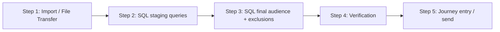

# Automation Studio

> **Type:** Guide · How to build automations that run on time, fail loudly and are easy to hand over: starting sources, activities, step design, error handling and monitoring.

[← Back to the handbook](../README.md)

---

## 1. Starting sources

| Source | Runs when | Notes |
|---|---|---|
| **Schedule** | At fixed times (hourly, daily, weekly…) | Times are set in the account's time zone setting shown in the UI; check it against server time when queries use `GETDATE()` |
| **File Drop** | A file lands in a folder of the Enhanced SFTP | Use filename patterns; one file = one run. Great for system integrations |
| **Run once** | Manually or via API | Ad-hoc loads, backfills, tests |

If a scheduled run is still executing when the next one is due, the next run is **skipped** ([skipped runs query](../sql/monitoring/automation-skipped-runs.sql)).

## 2. Activities you'll use most

| Activity | Does | Tip |
|---|---|---|
| **SQL Query** | Writes a SELECT result into a DE (Overwrite / Update / Append) | [Query Activity reference](../sql/query-activity.md) |
| **Import File** | Loads a file from SFTP into a DE or list | Define the update type (add only, update only, add and update, overwrite) on purpose |
| **File Transfer** | Moves/unzips/decrypts files between SFTP folders | Use before Import when files arrive compressed or encrypted |
| **Data Extract** | Exports DEs or tracking data to files | Tracking extract for data beyond Data Views; DE extract to CSV |
| **Script (SSJS)** | Custom logic, APIs, housekeeping | 30-minute limit; [SSJS guide](../javascript/ssjs/fundamentals.md) |
| **Verification** | Checks a DE's row count and stops or alerts | Stops a send when the audience is empty or suspiciously large |
| **Filter** | Applies a filter definition to a DE | Simple segmentation without SQL |
| **Send Email** | User-initiated send to a DE or list | Prefer journeys for anything with logic |
| **Fire Event / Journey entry** | Pushes a DE into a journey | Keep it in the same automation as the queries that build the audience |
| **Wait** | Pauses between steps | For external processes, not as a fix for race conditions inside the automation |

## 3. Steps and order

- **Steps run in sequence. Activities inside the same step run in parallel.** Put dependent queries in different steps.
- One automation = one pipeline with one purpose (`B2C_AUT_ONB_DailyEntry`). Avoid "god automations" that do everything at 6 AM.
- Typical pipeline:

- Use **staging DEs** (with data retention) between steps. They make each step testable and keep queries under 30 minutes.

## 4. Error handling

| Practice | How |
|---|---|
| Notifications | Set error (and skip) notification emails on every production automation, to a shared mailbox, not a person |
| Fail loudly | Script Activities re-throw after logging ([try-catch-log.ssjs](../javascript/ssjs/scripts/try-catch-log.ssjs)) |
| Guard sends | Verification activity before any send or journey entry (min/max row counts) |
| Idempotency | Queries with Overwrite/Update can be re-run safely; avoid Append in pipelines that may run twice |
| Central monitoring | [Monitoring queries](../sql/monitoring/) + [automation failure alerts](../playbooks/automation-failure-alerts/) |

## 5. Scheduling habits

- Spread heavy automations across the night; don't stack everything at the same minute.
- Know your clocks: schedules show the account time zone, SQL runs on server time (UTC−6), monitoring views use UTC ([dates and time zones](../sql/dates-and-time-zones.md)).
- Leave buffer between an upstream file drop and the automation that consumes it, or use File Drop as the trigger.
- Pause (don't delete) automations you retire, and document why.

## 6. Documentation for handover

For every production automation, keep (in the description field or your runbook):

| Field | Example |
|---|---|
| Purpose | Builds the daily welcome journey entry |
| Owner | Team / mailbox |
| Schedule | Daily 06:10 (Brasília) |
| Inputs | `Customers_DE` (CRM import), `_Sent` |
| Outputs | `B2C_DE_ONB_WelcomeEntry` → journey `B2C_JRN_ONB_Welcome` |
| Failure impact | Welcome emails delayed one day |
| How to re-run | Run once; queries are Overwrite, safe to repeat |

[← Back to the handbook](../README.md)
