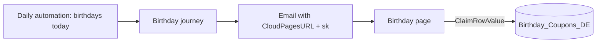

# Birthday page

> Personalized birthday page that gives each contact a unique coupon.

[Open the preview](https://igorbratti.github.io/sfmc-handbook/cloudpages/birthday-page/preview.html)

| | |
|---|---|
| **Status** | Ready to test |
| **Type** | CloudPage + birthday journey |
| **Level** | Intermediate |
| **Stack** | AMPscript (`ClaimRowValue`, `Lookup`, `FormatDate`), HTML/CSS |
| **Setup time** | ~30 min |

## 1. Use case
A birthday email links to this page. The contact sees a personal message and a coupon that is reserved for them only. Refreshing the page shows the same coupon.

## 2. How it works

- `ClaimRowValue` picks one unclaimed coupon, writes the subscriber key on it and sets `IsClaimed = true`.
- If the contact already has a coupon, the same one comes back.
- If the coupon pool is empty, the page shows a friendly message instead of an error.

## 3. Prerequisites
| DE | Field | Type | PK | Nullable |
|---|---|---|---|---|
| `Customers_DE` | `SubscriberKey` | Text 254 | ✔ | |
| | `FirstName` | Text 100 | | ✔ |
| `Birthday_Coupons_DE` | `CouponCode` | Text 50 | ✔ | |
| | `IsClaimed` | Boolean (default false) | | |
| | `SubscriberKey` | Text 254 | | ✔ |
| | `ExpiresAt` | Date | | |

Load `Birthday_Coupons_DE` with enough codes before the journey starts.

## 4. Setup
1. Create both data extensions and import the coupon codes.
2. Create the CloudPage with [`src/page.html`](src/page.html), publish and note the page ID.
3. In the birthday email: `<a href="%%=RedirectTo(CloudPagesURL(2345, "sk", _subscriberkey))=%%">Open my gift</a>`
4. Entry for the journey (daily query, example):
   ```sql
   SELECT SubscriberKey, FirstName, EmailAddress
   FROM [Customers_DE]
   WHERE MONTH(BirthDate) = MONTH(GETDATE())
     AND DAY(BirthDate) = DAY(GETDATE())
   ```

## 5. Key code
```ampscript
SET @coupon = ClaimRowValue("Birthday_Coupons_DE", "CouponCode", "IsClaimed", "", "SubscriberKey", @sk)

IF NOT Empty(@coupon) THEN
  SET @expiresAt = Lookup("Birthday_Coupons_DE", "ExpiresAt", "CouponCode", @coupon)
  SET @expires = FormatDate(@expiresAt, "MMMM d, yyyy", "", "en-US")
ENDIF
```
The fourth argument (`""`) is the value returned when no coupon is left, so the page never breaks.

## 6. Testing
- [ ] First open: a coupon is claimed and shown
- [ ] Refresh: the same coupon appears
- [ ] Another contact: gets a different coupon
- [ ] Empty pool: shows the fallback message

## 7. Security and privacy
The subscriber key travels encrypted. Each contact can only see their own coupon.

[← All CloudPages](../README.md)
