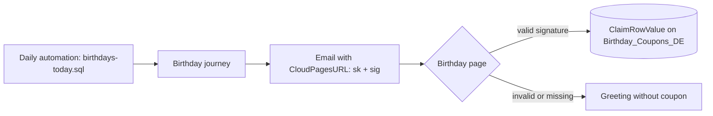

# Birthday page

> Personalized birthday page that gives each contact a unique coupon.

[Open the preview](https://igorbratti.github.io/sfmc-handbook/cloudpages/birthday-page/preview.html) · [Source](src/page.html)

| | |
|---|---|
| **Status** | Ready to test |
| **Type** | CloudPage + birthday journey |
| **Level** | Intermediate |
| **Stack** | AMPscript (`ClaimRowValue`, `Lookup`, `SHA256`, `FormatDate`), SQL, HTML/CSS |
| **Setup time** | ~30 min |

## 1. Use case
A birthday email links to this page. The contact sees a personal message and a coupon reserved for them only. Refreshing the page shows the same coupon.

## 2. How it works

- The subscriber key is accepted only with a valid signature. Without it, anyone could iterate keys in the URL and drain the coupon pool.
- `ClaimRowValue` picks one unclaimed coupon, writes the subscriber key on it and sets `IsClaimed = true`. If the contact already has a coupon, the same one comes back.
- When the pool is empty, the fourth argument (`""`) is returned instead of an error, and the page shows a friendly message.
- Corporate link scanners (Safe Links, Mimecast) may open the link before the person does. The claim still goes to the right contact, but your "claimed" count will include people who never opened the page. Measure redemption, not claims.

## 3. Prerequisites
| DE | Field | Type | PK | Nullable |
|---|---|---|---|---|
| `Customers_DE` | `SubscriberKey` | Text 254 | ✔ | |
| | `EmailAddress` | EmailAddress | | |
| | `FirstName` | Text 100 | | ✔ |
| | `BirthDate` | Date | | ✔ |
| `Birthday_Coupons_DE` | `CouponCode` | Text 50 | ✔ | |
| | `IsClaimed` | Boolean (default false) | | |
| | `SubscriberKey` | Text 254 | | ✔ |
| | `ExpiresAt` | Date | | |
| `Config_DE` | `Name` | Text 100 | ✔ | |
| | `Value` | Text 500 | | |

Load `Birthday_Coupons_DE` with more codes than the expected monthly volume, and monitor what is left with a daily query (`SELECT COUNT(*) ... WHERE IsClaimed = 0`) feeding an alert.

## 4. Setup
1. Create the data extensions, import the coupon codes and add the `LINK_SIGNING_SECRET` row to `Config_DE`.
2. Create the CloudPage with [`src/page.html`](src/page.html), publish and note the page ID.
3. Daily entry query: [`sql/audiences/birthdays-today.sql`](../../sql/audiences/birthdays-today.sql) (already converts to Brasília time) → `Birthdays_Today` (Overwrite) → journey entry source.
4. In the birthday email:
   ```ampscript
   %%[
   SET @secret = Lookup("Config_DE", "Value", "Name", "LINK_SIGNING_SECRET")
   SET @sig = SHA256(Concat(_subscriberkey, "|", @secret), "UTF-8")
   ]%%
   <a href="%%=RedirectTo(CloudPagesURL(2345, "sk", _subscriberkey, "sig", @sig))=%%" alias="birthday_gift">Open my gift</a>
   ```

## 5. Key code
```ampscript
IF Empty(@sk) OR Empty(@secret) OR @sig != SHA256(Concat(@sk, "|", @secret), "UTF-8") THEN
  SET @sk = ""
ENDIF

SET @coupon = ClaimRowValue("Birthday_Coupons_DE", "CouponCode", "IsClaimed", "", "SubscriberKey", @sk)
```

## 6. Testing
- [ ] First open from the email: a coupon is claimed and shown
- [ ] Refresh: the same coupon appears
- [ ] Another contact: gets a different coupon
- [ ] Plain `?sk=<key>` or a tampered `sig`: greeting without coupon, nothing claimed
- [ ] Empty pool: shows the fallback message

## 7. Security and privacy
Signed identity, `noindex`, and the first name is allow-listed before it is printed. See the [security guide](../security.md).

[← All CloudPages](../README.md)
