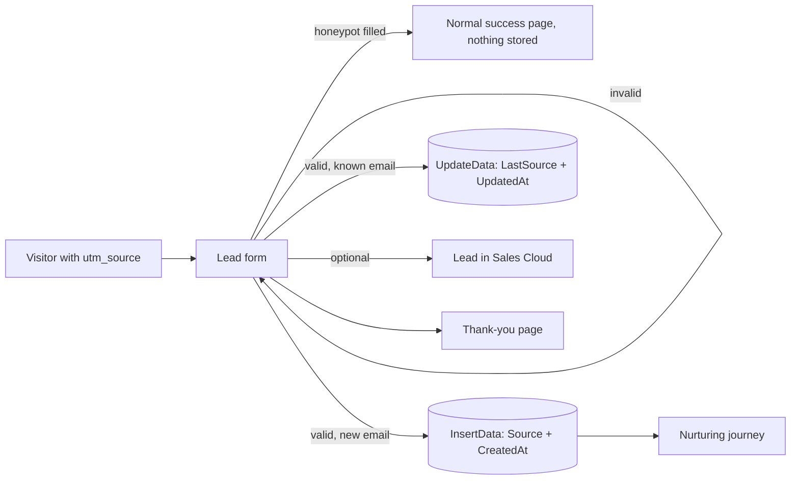

# Lead capture form (click-to-lead)

> A form that turns visitors into leads in Marketing Cloud, with server-side validation, anti-spam, consent evidence and first-touch attribution. Optionally creates the lead in Sales Cloud.

[Open the preview](https://igorbratti.github.io/sfmc-handbook/cloudpages/lead-capture-form/preview.html) · [Source](src/page.html)

| | |
|---|---|
| **Status** | Ready to test |
| **Type** | CloudPage |
| **Level** | Intermediate |
| **Stack** | AMPscript (`InsertData`, `UpdateData`, `RegExMatch`, `IsEmailAddress`, `Redirect`, optional `CreateSalesforceObject`), HTML/CSS |
| **Setup time** | ~30 min |

## 1. Use case
Campaign traffic (ads, emails, WhatsApp) lands on the form. Each valid submission becomes a lead in a data extension, ready to enter a nurturing journey or to be called by the sales team.

## 2. How it works

- **Validation on the server:** names must contain only letters, spaces, apostrophes or hyphens; email via `IsEmailAddress`; phone optional but, when filled, 8–15 digits after normalization; consent required; `interest` must be one of the offered options.
- **Honeypot:** a hidden field that humans never see. When it is filled, the visitor is redirected as if everything worked and nothing is stored.
- **Attribution:** `Source` and `CreatedAt` are written only when the email is new (first touch). `LastSource` and `UpdatedAt` change on every submission (last touch). An upsert would overwrite both and lose the first touch.
- **Safe output:** `utm_source` is allow-listed before it is printed into the hidden field, which closes a reflected XSS. See the [security guide](../security.md#2-allow-list-every-value-you-print).
- Redirects to the [thank-you page](../thank-you-page/) with the first name, encrypted by `CloudPagesURL`.

## 3. Prerequisites
| DE `Leads_DE` | Type | PK | Nullable |
|---|---|---|---|
| `EmailAddress` | EmailAddress | ✔ | |
| `FirstName` | Text 100 | | |
| `LastName` | Text 100 | | |
| `Phone` | Text 20 | | ✔ |
| `Interest` | Text 50 | | |
| `Consent` | Boolean | | |
| `ConsentAt` | Date | | |
| `Source` | Text 50 | | |
| `LastSource` | Text 50 | | |
| `CreatedAt` | Date | | |
| `UpdatedAt` | Date | | |

For the optional Sales Cloud lead: Marketing Cloud Connect configured, with permission to create Leads.

## 4. Setup
1. Create `Leads_DE`.
2. Create the CloudPage with [`src/page.html`](src/page.html).
3. Replace `1234` with the thank-you page ID and publish.
4. Share the link with UTMs, for example `...?utm_source=instagram`.
5. Optional: uncomment the `CreateSalesforceObject` block.
6. Optional: use `Leads_DE` as the entry source of a nurturing journey (entry on new records only).
7. Optional: add [`form-enhancements.js`](../../javascript/client-side/form-enhancements.js) for inline validation and double-submit protection.

## 5. Key code
```ampscript
SET @source = RegExMatch(RequestParameter("utm_source"), "^[A-Za-z0-9_.-]{1,50}$", 0)
IF Empty(@source) THEN SET @source = "direct" ENDIF

SET @existing = Lookup("Leads_DE", "EmailAddress", "EmailAddress", @email)
IF Empty(@existing) THEN
  InsertData("Leads_DE", "EmailAddress", @email, ..., "Source", @source, "CreatedAt", @now, "UpdatedAt", @now)
ELSE
  UpdateData("Leads_DE", 1, "EmailAddress", @email, ..., "LastSource", @source, "UpdatedAt", @now)
ENDIF
```

## 6. Testing
- [ ] Valid submission, new email → one row with `Source`, `CreatedAt`; redirect to the thank-you page
- [ ] Same email again from another `utm_source` → `Source` and `CreatedAt` unchanged; `LastSource` and `UpdatedAt` updated
- [ ] Invalid email or a name with digits/HTML → error message, nothing stored
- [ ] No consent → error message, nothing stored
- [ ] Honeypot filled (use the browser dev tools) → redirect, nothing stored
- [ ] `?utm_source="><b>x</b>` → the hidden field contains `direct`, nothing is rendered as HTML

## 7. Security and privacy
- Every value is validated on the server; the browser `required` attribute is only a convenience.
- Error messages are fixed text and never echo what the user typed.
- Consent and timestamp stored for LGPD/GDPR. Dates are server time (US Central, UTC−6).

[← All CloudPages](../README.md)
