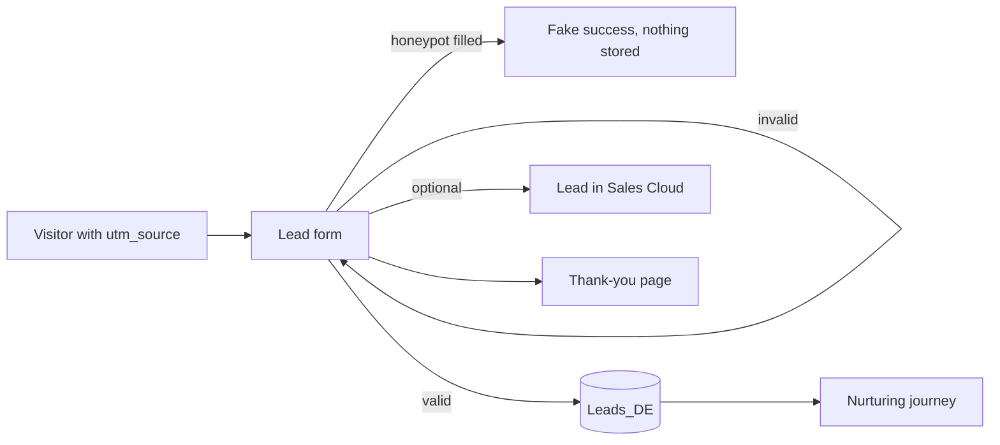

# Lead capture form (click-to-lead)

> A form that turns visitors into leads in Marketing Cloud, with validation, anti-spam and consent, and can also create the lead in Sales Cloud.

[Open the preview](https://igorbratti.github.io/sfmc-handbook/cloudpages/lead-capture-form/preview.html)

| | |
|---|---|
| **Type** | CloudPage |
| **Level** | Intermediate |
| **Stack** | AMPscript (`UpsertData`, `IsEmailAddress`, `Redirect`, optional `CreateSalesforceObject`), HTML/CSS |
| **Setup time** | ~30 min |

## 1. Use case
Campaign traffic (ads, emails, WhatsApp) lands on the form. Each valid submission becomes a lead in a data extension, ready to enter a nurturing journey or to be called by the sales team.

## 2. How it works

- Validates name, email (`IsEmailAddress`) and consent on the server.
- A hidden **honeypot** field catches simple bots: humans never see it, bots fill it.
- Normalizes the phone (removes spaces, dashes and parentheses).
- Saves consent and its timestamp as evidence.
- Keeps `utm_source` for attribution.
- Redirects to the [thank-you page](../thank-you-page/) with the first name.

## 3. Prerequisites
| DE `Leads_DE` | Type | PK |
|---|---|---|
| `EmailAddress` | EmailAddress | ✔ |
| `FirstName` | Text 100 | |
| `LastName` | Text 100 | |
| `Phone` | Text 20 | |
| `Interest` | Text 50 | |
| `Consent` | Boolean | |
| `ConsentAt` | Date | |
| `Source` | Text 100 | |
| `CreatedAt` | Date | |

For the optional Sales Cloud lead: Marketing Cloud Connect configured, with permission to create Leads.

## 4. Setup
1. Create `Leads_DE`.
2. Create the CloudPage with [`src/page.html`](src/page.html).
3. Replace `1234` with the thank-you page ID and publish.
4. Share the link with UTMs, for example `...?utm_source=instagram`.
5. Optional: uncomment the `CreateSalesforceObject` block.
6. Optional: use `Leads_DE` as the entry source of a nurturing journey.

## 5. Key code
```ampscript
IF NOT Empty(@honeypot) THEN
  Redirect(CloudPagesURL(1234))
ELSEIF Empty(@firstName) OR Empty(@lastName) OR NOT IsEmailAddress(@email) THEN
  SET @error = "Please fill in your name and a valid email address."
ELSEIF @consent != "on" THEN
  SET @error = "Please accept the privacy terms to continue."
ELSE
  UpsertData("Leads_DE", 1, "EmailAddress", @email, ... , "ConsentAt", Now())
  Redirect(CloudPagesURL(1234, "fn", @firstName))
ENDIF
```

## 6. Testing
- [ ] Valid submission → row in `Leads_DE` and redirect to the thank-you page
- [ ] Invalid email → error message, nothing stored
- [ ] No consent → error message, nothing stored
- [ ] Honeypot filled (use the browser dev tools) → redirect, nothing stored
- [ ] Same email twice → one row, updated (upsert)

## 7. Security and privacy
- Server-side validation (the browser `required` attribute is only a convenience).
- Error messages never echo what the user typed.
- Consent and timestamp stored for LGPD/GDPR.

[← All CloudPages](../README.md)
