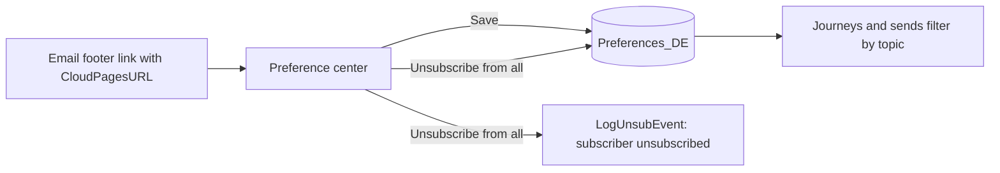

# Preference center

> Lets each contact choose which emails they want, or unsubscribe from everything, with a real unsubscribe logged in Marketing Cloud.

[Open the preview](https://igorbratti.github.io/sfmc-handbook/cloudpages/preference-center/preview.html)

| | |
|---|---|
| **Status** | Ready to test |
| **Type** | CloudPage |
| **Level** | Advanced |
| **Stack** | AMPscript (`UpsertData`, `Lookup`, `LogUnsubEvent` via `InvokeExecute`), HTML/CSS |
| **Setup time** | ~45 min |

## 1. Use case
Instead of losing a contact with a single "unsubscribe" link, offer topics (newsletter, offers, events). People who only want fewer emails stay; people who want out can leave with one click.

## 2. How it works

- The footer link passes the subscriber key and the send identifiers (`jobid`, `listid`, `_JobSubscriberBatchID`), encrypted.
- **Save** updates the three topic flags.
- **Unsubscribe from all** clears the flags and calls `LogUnsubEvent`, which unsubscribes the contact and links the unsubscribe to the email they came from, so it shows up in tracking.
- Without a valid link, the page shows a message instead of a form.

## 3. Prerequisites
| DE `Preferences_DE` | Type | PK |
|---|---|---|
| `SubscriberKey` | Text 254 | ✔ |
| `Newsletter` | Boolean | |
| `Offers` | Boolean | |
| `Events` | Boolean | |
| `UpdatedAt` | Date | |

Use the topic flags in your audience queries, for example `WHERE p.Offers = 1`.

## 4. Setup
1. Create `Preferences_DE`.
2. Create the CloudPage with [`src/page.html`](src/page.html) and publish it.
3. In the email footer:
   ```
   %%=RedirectTo(CloudPagesURL(3456, "sk", _subscriberkey, "jid", jobid, "lid", listid, "bid", _JobSubscriberBatchID))=%%
   ```
4. Add the topic filters to the queries that build your audiences.

## 5. Key code: logging the unsubscribe
```ampscript
SET @lue = CreateObject("ExecuteRequest")
SetObjectProperty(@lue, "Name", "LogUnsubEvent")

SET @prop = CreateObject("APIProperty")
SetObjectProperty(@prop, "Name", "SubscriberKey")
SetObjectProperty(@prop, "Value", @sk)
AddObjectArrayItem(@lue, "Parameters", @prop)

/* JobID, ListID and BatchID are added the same way when present */

SET @statusCode = InvokeExecute(@lue, @statusMsg, @requestId)
```

## 6. Testing
- [ ] Open from a test email: current preferences are pre-checked
- [ ] Save: `Preferences_DE` updated, success message shown
- [ ] Unsubscribe from all: flags cleared, subscriber status becomes Unsubscribed, unsubscribe appears in the email's tracking
- [ ] Open without parameters: "This link is not valid"

## 7. Security and privacy
- The subscriber key is never in plain text, so nobody can change someone else's preferences by editing the URL.
- Unsubscribes are processed immediately (CAN-SPAM, LGPD, GDPR).
- Test in a sandbox or test BU first: the unsubscribe is real.

[← All CloudPages](../README.md)
