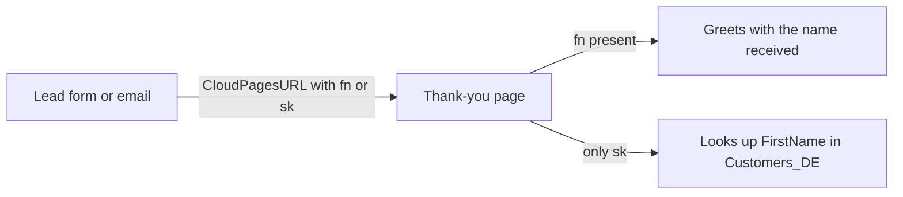

# Thank-you page

> Personalized confirmation page shown after a form submission or opened from an email.

[Open the preview](https://igorbratti.github.io/sfmc-handbook/cloudpages/thank-you-page/preview.html)

| | |
|---|---|
| **Type** | CloudPage |
| **Level** | Beginner |
| **Stack** | AMPscript, HTML/CSS |
| **Setup time** | ~15 min |

## 1. Use case
After a lead form or a purchase, the contact lands on a page that greets them by name and says what happens next. Works as the destination of the [lead capture form](../lead-capture-form/).

## 2. How it works

- Reads `fn` (first name) or `sk` (subscriber key) from the encrypted query string.
- If only `sk` arrives, it looks up the name in `Customers_DE`.
- Without any parameter it still works, with a generic "Thank you!".

## 3. Prerequisites
| DE | Field | Type | PK |
|---|---|---|---|
| `Customers_DE` | `SubscriberKey` | Text 254 | ✔ |
| | `FirstName` | Text 100 | |

Only needed when you link with `sk`.

## 4. Setup
1. Create the CloudPage and paste [`src/page.html`](src/page.html).
2. Publish and note the page ID.
3. Link to it:
   - from an email: `%%=RedirectTo(CloudPagesURL(1234, "sk", _subscriberkey))=%%`
   - from a CloudPage form: `Redirect(CloudPagesURL(1234, "fn", @firstName))`

## 5. Key code
```ampscript
SET @firstName = RequestParameter("fn")
SET @sk = RequestParameter("sk")

IF Empty(@firstName) AND NOT Empty(@sk) THEN
  SET @firstName = Lookup("Customers_DE", "FirstName", "SubscriberKey", @sk)
ENDIF
```
`RequestParameter` reads the values that `CloudPagesURL` encrypted into the `qs` parameter.

## 6. Testing
- [ ] With `fn`: shows "Thank you, Maria!"
- [ ] With `sk` of a contact that has a first name in `Customers_DE`
- [ ] With no parameters: shows "Thank you!"

## 7. Security and privacy
Parameters are encrypted by `CloudPagesURL`. The page only shows a first name and has `noindex`.

[← All CloudPages](../README.md)
