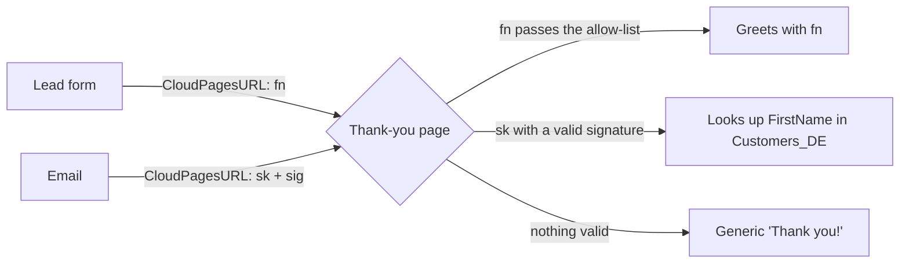

# Thank-you page

> Personalized confirmation page shown after a form submission or opened from an email.

[Open the preview](https://igorbratti.github.io/sfmc-handbook/cloudpages/thank-you-page/preview.html) · [Source](src/page.html)

| | |
|---|---|
| **Status** | Ready to test |
| **Type** | CloudPage |
| **Level** | Beginner |
| **Stack** | AMPscript (`RequestParameter`, `RegExMatch`, `SHA256`, `Lookup`), HTML/CSS |
| **Setup time** | ~15 min |

## 1. Use case
After a lead form or a purchase, the contact lands on a page that greets them by name and says what happens next. It is the destination of the [lead capture form](../lead-capture-form/).

## 2. How it works

- `fn` is printed on the page, so it must match an allow-list of letters, spaces, apostrophes and hyphens. Anything else is ignored.
- `sk` is an identity. It is used only when its signature is valid, so nobody can read another contact's first name by editing the URL.
- With no valid parameter the page still works and shows a generic message.

## 3. Prerequisites
| DE | Field | Type | PK |
|---|---|---|---|
| `Customers_DE` | `SubscriberKey` | Text 254 | ✔ |
| | `FirstName` | Text 100 | |
| `Config_DE` | `Name` | Text 100 | ✔ |
| | `Value` | Text 500 | |

`Config_DE` holds the `LINK_SIGNING_SECRET` row. Both DEs are only needed when you link with `sk`. See the [security guide](../security.md#1-sign-every-link-that-carries-an-identity).

## 4. Setup
1. Create the CloudPage and paste [`src/page.html`](src/page.html). Publish and note the page ID.
2. Link to it:
   - after a form post: `Redirect(CloudPagesURL(1234, "fn", @firstName))`
   - from an email:
     ```ampscript
     %%[ SET @sig = SHA256(Concat(_subscriberkey, "|", Lookup("Config_DE", "Value", "Name", "LINK_SIGNING_SECRET")), "UTF-8") ]%%
     <a href="%%=RedirectTo(CloudPagesURL(1234, "sk", _subscriberkey, "sig", @sig))=%%">Open</a>
     ```

## 5. Key code
```ampscript
SET @firstName = RegExMatch(RequestParameter("fn"), "^[\p{L} '-]{1,50}$", 0)

IF Empty(@firstName) AND NOT Empty(@sk) THEN
  SET @secret = Lookup("Config_DE", "Value", "Name", "LINK_SIGNING_SECRET")
  IF NOT Empty(@secret) AND @sig == SHA256(Concat(@sk, "|", @secret), "UTF-8") THEN
    SET @firstName = Lookup("Customers_DE", "FirstName", "SubscriberKey", @sk)
  ENDIF
ENDIF
```

## 6. Testing
- [ ] From the lead form: shows "Thank you, Maria!"
- [ ] From an email with `sk` + `sig`: shows the first name stored in `Customers_DE`
- [ ] Plain `?sk=<any key>` without a signature: shows "Thank you!"
- [ ] `?fn=<b>Test</b>`: shows "Thank you!" (the value is rejected, nothing is rendered as HTML)
- [ ] No parameters: shows "Thank you!"

## 7. Security and privacy
Values are allow-listed before they are printed, identities require a signature, and the page has `noindex`. Details in the [security guide](../security.md).

[← All CloudPages](../README.md)
