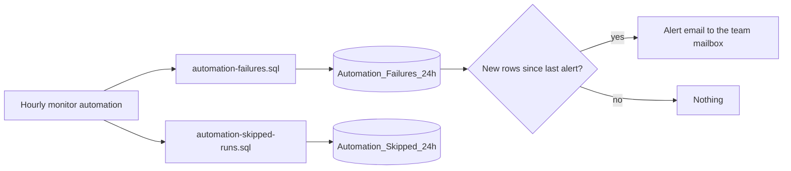

# Automation failure alerts

> **Status: v1.0, ready to test.** One automation that watches all the others and emails the team when something failed or was skipped, with the failing activity and error message.

| | |
|---|---|
| **Type** | Playbook (automation + email) |
| **Level** | Intermediate |
| **Stack** | SQL on `_AutomationInstance` / `_AutomationActivityInstance`, Verification activity, Email Studio or Journey Builder |
| **Setup time** | ~1 hour per business unit |

## 1. Why
Built-in notifications go to whoever typed an address in each automation, and skipped runs are easy to miss. A central monitor gives one view, one alert format and history for the whole business unit.

## 2. How it works


## 3. Data extensions
| DE | Purpose |
|---|---|
| `Automation_Failures_24h` | Output of [automation-failures.sql](../../sql/monitoring/automation-failures.sql) (schema in the [monitoring README](../../sql/monitoring/)) |
| `Automation_Skipped_24h` | Output of [automation-skipped-runs.sql](../../sql/monitoring/automation-skipped-runs.sql) |
| `Automation_Alerts_Sent` | `AutomationInstanceID` (PK), `AlertedAt`: runs already reported, so each failure alerts once |
| `Automation_Alert_Queue` | Rows to alert now (failures not yet in `Automation_Alerts_Sent`) |
| `Alert_Recipients` | Sendable DE with the team mailbox(es) |

## 4. Setup

1. **Monitor automation** (`OPS_AUT_MON_AutomationHealth`), hourly:
   - Step 1: `automation-failures.sql` → `Automation_Failures_24h` (Overwrite) and `automation-skipped-runs.sql` → `Automation_Skipped_24h` (Overwrite), in parallel.
   - Step 2: queue query → `Automation_Alert_Queue` (Overwrite):
     ```sql
     SELECT f.AutomationInstanceID, f.ActivityStep, f.AutomationName, f.ActivityName, f.ErrorDetails,
            f.AutomationInstanceStartTime_UTC, 1 AS QueueFlag
     FROM [Automation_Failures_24h] f
     LEFT JOIN [Automation_Alerts_Sent] s ON s.AutomationInstanceID = f.AutomationInstanceID
     WHERE s.AutomationInstanceID IS NULL
     ```
   - Step 3: **Verification** activity on `Automation_Alert_Queue`: stop the automation when the count is 0.
   - Step 4: send the alert email to `Alert_Recipients`.
   - Step 5: mark as alerted → `Automation_Alerts_Sent` (Update):
     ```sql
     SELECT DISTINCT q.AutomationInstanceID, GETDATE() AS AlertedAt
     FROM [Automation_Alert_Queue] q
     ```
2. **Alert email** (HTML paste email, transactional-style content, internal recipients only) lists the queue:
   ```ampscript
   %%[
   SET @rows = LookupOrderedRows("Automation_Alert_Queue", 50, "AutomationInstanceStartTime_UTC DESC", "QueueFlag", 1)
   SET @count = RowCount(@rows)
   ]%%
   <p>%%=v(@count)=%% failed automation run(s) in the last 24 hours.</p>
   <table cellpadding="6" cellspacing="0" border="1">
     <tr><th>Automation</th><th>Step</th><th>Activity</th><th>Error</th></tr>
     %%[ FOR @i = 1 TO @count DO SET @r = Row(@rows, @i) ]%%
     <tr>
       <td>%%=v(Field(@r, 'AutomationName'))=%%</td>
       <td>%%=v(Field(@r, 'ActivityStep'))=%%</td>
       <td>%%=v(Field(@r, 'ActivityName'))=%%</td>
       <td>%%=v(Field(@r, 'ErrorDetails'))=%%</td>
     </tr>
     %%[ NEXT @i ]%%
   </table>
   ```
   `Automation_Alert_Queue`: `AutomationInstanceID` + `ActivityStep` (PK), the other columns of `Automation_Failures_24h`, and `QueueFlag` (Number).
3. Add the skipped runs to the same email (second table) or to a daily digest.
4. Repeat per business unit, or run the monitor in each BU and send to the same mailbox.

## 5. Testing
- [ ] Create a test automation with a query that fails on purpose (invalid column) and run it once
- [ ] Within one monitor cycle, the alert arrives with the automation name, activity and error
- [ ] The next cycle doesn't alert again for the same run
- [ ] With no failures, the Verification activity stops the monitor before the send

## 6. Next steps
- A CloudPage dashboard over the three monitoring DEs.
- Duration trend from [activity-durations.sql](../../sql/monitoring/activity-durations.sql) to warn before queries reach the 30-minute limit.

[← All playbooks](../README.md)
