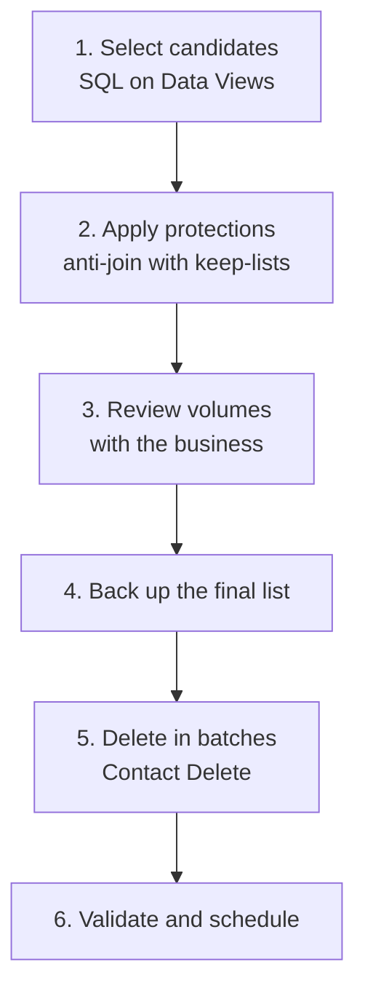

# Contact cleanup

> **Status: draft v0.1.** Structure and selection queries are ready; the deletion script is the next step.

Remove inactive contacts from Marketing Cloud safely: lower contract costs, better deliverability and faster queries.

| | |
|---|---|
| **Type** | Playbook (automation + manual review) |
| **Level** | Advanced |
| **Stack** | SQL (Data Views), Automation Studio, Contact Builder |
| **Real result** | Used to remove 4M inactive contacts, bringing an account from ~10M back under its 8M-contact limit |

## 1. When to run it
- The account is close to (or above) the contracted contact count.
- Deliverability is dropping: many sends to people who never engage.
- As a routine, every quarter.

## 2. The process

## 3. Step by step

### Step 1: select candidates
Use the queries in [`sql/hygiene`](../../sql/hygiene/):
- `inactive-contacts.sql`: received 5+ emails in 180 days and never opened or clicked.
- `never-sent-contacts.sql`: joined more than 180 days ago and never received an email.

Target: `Cleanup_Candidates` (PK `SubscriberKey`).

### Step 2: apply protections
Build a keep-list and remove it with an anti-join ([`sql/patterns`](../../sql/patterns/)). Typical keep rules:
- Active customers or contracts
- Contacts currently in a running journey
- Records synced from Sales/Service Cloud (handled by the CRM process instead)
- Legal or business holds

### Step 3: review volumes
Share the counts by rule with the business owner before deleting anything. Get written approval.

### Step 4: back up
Copy the final list, with the attributes you might need later, to `Cleanup_Backup_<date>`.

### Step 5: delete
- **Contact Builder → Contact Delete**, using the final data extension, in batches.
- Deletion is permanent after the suppression period configured in the account. Start with a small batch and check the result.
- Next version of this playbook: a script that deletes through the Contacts REST API, for scheduling.

### Step 6: validate and schedule
- Compare the contact count before and after.
- Turn steps 1–4 into a monthly automation, and repeat deletion after review.

## 4. Data extensions
| DE | Key | Purpose |
|---|---|---|
| `Cleanup_Candidates` | `SubscriberKey` | Output of step 1 |
| `Cleanup_KeepList` | `SubscriberKey` | Contacts that must never be deleted |
| `Cleanup_Final` | `SubscriberKey` | Candidates minus keep-list |
| `Cleanup_Backup_<date>` | `SubscriberKey` | Snapshot before deletion |

## 5. Risks and how to avoid them
| Risk | Mitigation |
|---|---|
| Deleting a customer | Keep-list + business approval |
| Data Views only cover ~6 months | Treat "no activity" as "no activity in the window"; check older history if you keep it |
| Apple Mail Privacy inflates opens | The selection is conservative: some inactive people look active |
| Irreversible deletion | Backup + small first batch |

## Changelog
- v0.1: process, selection, protections and manual deletion.

[← All playbooks](../README.md)
