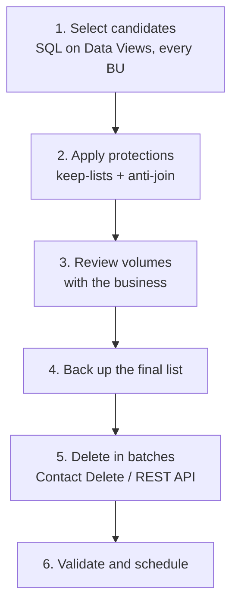

# Contact cleanup

> **Status: v0.2.** Selection, protections, review and deletion steps documented; scheduled API deletion is the next step.

Remove inactive contacts from Marketing Cloud safely: lower contract costs, better deliverability and faster queries.

| | |
|---|---|
| **Type** | Playbook (automation + manual review) |
| **Level** | Advanced |
| **Stack** | SQL (Data Views), Automation Studio, Contact Builder, Contacts REST API |
| **Real result** | Used to remove 4M inactive contacts, bringing an account from ~10M back under its 8M-contact limit |

## 1. When to run it
- The account is close to (or above) the contracted contact count.
- Deliverability is dropping: many sends to people who never engage.
- As a routine, every quarter.

## 2. What counts as a contact
Marketing Cloud bills on **contacts in All Contacts**, not only email subscribers. A person can be a contact because of email, SMS (MobileConnect), WhatsApp, push (MobilePush), a synchronized Salesforce object or a journey entry. Measure the count in **Contact Builder → All Contacts** before and after, and decide channel by channel.

## 3. The process

## 4. Step by step

### Step 1: select candidates
Queries in [`sql/hygiene`](../../sql/hygiene/), all writing to `Cleanup_Candidates` (PK `SubscriberKey`):
- `inactive-contacts.sql`: received 5+ emails in 180 days and never opened or clicked.
- `collect-sent-keys.sql` (every BU) → `never-sent-contacts.sql`: joined more than 180 days ago and no BU has emailed them.

For non-email contacts, add equivalent rules: SMS numbers with no outbound message and no opt-in activity in the window (`_SMSMessageTracking`, `_SMSSubscriptionLog`), push devices without activity.

### Step 2: apply protections
Build `Cleanup_KeepList` and remove it with an anti-join ([`sql/patterns`](../../sql/patterns/)). Typical keep rules:

| Keep rule | Source |
|---|---|
| Engaged in **any** BU in the window | `collect-engaged-keys.sql` → `Engaged_Keys_All_BUs` |
| Active customers or contracts | CRM / customer DE |
| Contacts in a running journey | Journey entry DEs of running journeys |
| Records synchronized from Sales/Service Cloud | Synchronized DEs (handle in the CRM process instead) |
| Recent signups and transactional-only contacts | Signup date, transactional send logs |
| Legal or business holds | Holds DE |

Result: `Cleanup_Final` (PK `SubscriberKey`).

### Step 3: review volumes
Share counts by rule and by channel with the business owner before deleting anything. Get written approval and keep it with the backup.

### Step 4: back up
Copy `Cleanup_Final` with the attributes you may need later (keys, email, phone, last activity) to `Cleanup_Backup_<yyyymmdd>`. Export it to SFTP as well if the account's retention policies could delete the DE.

### Step 5: delete
Two options, both irreversible after the account's suppression period:

| Option | How | Best for |
|---|---|---|
| **Contact Builder → Contact Delete** | Select the `Cleanup_Final` DE as the source | One-off cleanups, manual control |
| **Contacts REST API** | `POST /contacts/v1/contacts/actions/delete?type=keys` in batches ([REST reference](../../apis/rest-reference.md#delete-contacts-by-key)) | Scheduled, repeatable cleanups |

- Start with a small batch (a few hundred contacts), check the result in All Contacts, then continue in batches.
- Log every batch (keys, date, operation ID) in `Cleanup_Log_DE`.

### Step 6: validate and schedule
- Compare the contact count before and after (allow for the suppression period).
- Turn steps 1–4 into a monthly automation; keep deletion behind a manual approval.

## 5. Data extensions
| DE | Key | Purpose |
|---|---|---|
| `Sent_Keys_All_BUs` (shared) | `SubscriberKey` | Keys emailed by any BU (step 1) |
| `Engaged_Keys_All_BUs` (shared) | `SubscriberKey` | Keys that opened or clicked in any BU (step 2) |
| `Cleanup_Candidates` | `SubscriberKey` | Output of step 1 |
| `Cleanup_KeepList` | `SubscriberKey` | Contacts that must never be deleted |
| `Cleanup_Final` | `SubscriberKey` | Candidates minus keep-list |
| `Cleanup_Backup_<yyyymmdd>` | `SubscriberKey` | Snapshot before deletion |
| `Cleanup_Log_DE` | `BatchId` | Deletion batches and operation IDs |

## 6. Risks and how to avoid them
| Risk | Mitigation |
|---|---|
| Deleting a customer | Keep-list + business approval |
| Contact active in another BU | Selection and engagement collected in every BU |
| Data Views only cover ~6 months | Treat "no activity" as "no activity in the window"; check older history if you keep it |
| Apple Mail Privacy inflates opens | The selection is conservative: some inactive people look active |
| Non-email contacts ignored | Channel-specific rules in step 1 |
| Irreversible deletion | Backup + small first batch + log |

## Changelog
- v0.2: multi-BU selection and engagement keep-list, non-email contacts, REST API deletion option, deletion log.
- v0.1: process, selection, protections and manual deletion.

[← All playbooks](../README.md)
