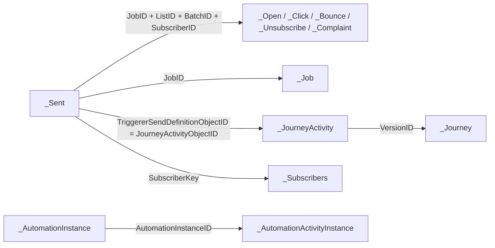

# Data Views reference

> **Type:** Reference · The system tables you query in Marketing Cloud: what each one holds, its main fields, how to join them, time zones, scope and retention.

[← SQL](README.md) · Query rules: [query-activity.md](query-activity.md) · Time zones: [dates-and-time-zones.md](dates-and-time-zones.md)

**Jump to:** [Rules that apply to all](#rules-that-apply-to-all-data-views) · [Email tracking](#email-tracking) · [Sends and jobs](#sends-and-jobs) · [Subscribers](#subscribers-and-status) · [Journeys](#journeys) · [Automations](#automations) · [Mobile](#mobile) · [Join map](#join-map) · [Recipes](#recipes)

---

## Rules that apply to all Data Views

| Rule | Detail |
|---|---|
| **Read-only** | Use them in `FROM` / `JOIN`. They never appear in Contact Builder or Email Studio lists |
| **No brackets needed** | `FROM _Sent s`. Brackets are for DE names with spaces |
| **Business-unit scope** | A query sees the data of the BU where it runs. From a child BU, `ENT._Subscribers` (and other `ENT.` views) read the parent level |
| **Retention** | Tracking views keep about **6 months**, rolling. Journey metadata is not purged on that cycle. Automation views cover about the last 31 days |
| **Time zone** | Tracking and journey dates: **US Central, UTC−6, no daylight saving**. Fields ending in `_UTC` are UTC |
| **Copy what you need to keep** | Anything you need beyond the window (last engagement date, history for audits) must be copied into your own DE on a schedule |

Retention and scope can vary by account and contract. Confirm in your own org before building on a limit.

## Email tracking

All tracking views share the **send key**: `JobID`, `ListID`, `BatchID`, `SubscriberID` (plus `SubscriberKey`). They also carry `AccountID`, `OYBAccountID`, `EventDate`, `Domain`, `TriggererSendDefinitionObjectID` and `TriggeredSendCustomerKey`.

| View | One row per | Extra fields worth knowing |
|---|---|---|
| `_Sent` | Email sent to a subscriber | — |
| `_Open` | Open event | `IsUnique` (first open of that subscriber in that job) |
| `_Click` | Click event | `URL`, `LinkName` (the `alias`), `LinkContent`, `IsUnique` (first click of that subscriber in that job) |
| `_Bounce` | Bounce event | `BounceCategory` (`Hard bounce`, `Soft bounce`, `Block bounce`, `Technical/Other bounce`, `Unknown bounce`), `BounceSubcategory`, `BounceType`, `SMTPCode`, `SMTPBounceReason`, `IsUnique` |
| `_Unsubscribe` | Unsubscribe tied to a send | `IsUnique` |
| `_Complaint` | Spam complaint reported by a mailbox provider | `IsUnique` |
| `_FTAF` | Forward-to-a-friend event | — |

Notes:
- **Opens are inflated** by Apple Mail Privacy Protection and corporate scanners. Use clicks for engagement decisions.
- `_Click` has one row per click. For "who clicked", use `IsUnique = 1` or `COUNT(DISTINCT SubscriberKey)` per job.
- `TriggererSendDefinitionObjectID` is filled for triggered and journey sends and links tracking to journeys (see [join map](#join-map)).

## Sends and jobs

| View | One row per | Main fields |
|---|---|---|
| `_Job` | Send job (a user-initiated send, or a triggered/journey email definition) | `JobID`, `EmailID`, `EmailName`, `EmailSubject`, `FromName`, `FromEmail`, `SchedTime`, `DeliveredTime`, `JobStatus`, `JobType`, `Category`, `SendClassification`, `SendClassificationType`, `TriggeredSendCustomerKey`, `TriggererSendDefinitionObjectID` |

Join `_Job` to tracking on `JobID` to report by email name and subject, or to separate commercial and transactional sends via the send classification.

## Subscribers and status

| View | One row per | Main fields |
|---|---|---|
| `_Subscribers` | Subscriber in All Subscribers | `SubscriberID`, `SubscriberKey`, `EmailAddress`, `Status` (`Active`, `Bounced`, `Held`, `Unsubscribed`), `DateJoined`, `DateUnsubscribed`, `DateUndeliverable`, `BounceCount`, `Domain`, `SubscriberType`, `Locale` |
| `_ListSubscribers` | Subscriber in a list or publication list | `ListID`, `ListName`, `ListType`, `SubscriberKey`, `EmailAddress`, `Status`, `AddMethod`, `AddedBy`, `CreatedDate`, `DateUnsubscribed` |
| `_BusinessUnitUnsubscribes` | Subscriber unsubscribed at business-unit level | `BusinessUnitID`, `SubscriberID`, `SubscriberKey`, `UnsubDateUTC`, `UnsubReason` |
| `_EnterpriseAttribute` | Subscriber profile attributes (Enterprise 2.0) | `_SubscriberID` plus one column per profile attribute |

`Held` means the address bounced too many times and Marketing Cloud stopped sending to it. Exclude `Held`, `Bounced` and `Unsubscribed` before counting a reachable audience.

## Journeys

| View | One row per | Main fields |
|---|---|---|
| `_Journey` | Journey **version** | `JourneyID` (stable across versions), `VersionID`, `VersionNumber`, `JourneyName`, `JourneyStatus` (`Draft`, `Running`, `Stopped`, `Finishing`…), `CreatedDate`, `LastPublishedDate`, `ModifiedDate` |
| `_JourneyActivity` | Activity in a journey version | `VersionID`, `ActivityID`, `ActivityName`, `ActivityExternalKey`, `ActivityType`, `JourneyActivityObjectID` |

Journey **contact history** (who is in which activity) is not in Data Views. Use Journey Builder's history (about 30 days) or log entries yourself.

## Automations

Both views are BU-scoped and use UTC (`_UTC` fields).

| View | One row per | Main fields |
|---|---|---|
| `_AutomationInstance` | Automation run | `AutomationName`, `AutomationCustomerKey`, `AutomationType`, `AutomationInstanceID`, `AutomationInstanceIsRunOnce`, `FilenameFromTrigger`, `AutomationInstanceScheduledTime_UTC`, `AutomationInstanceStartTime_UTC`, `AutomationInstanceEndTime_UTC`, `AutomationInstanceStatus`, `AutomationInstanceActivityErrorDetails`, `AutomationStepCount`, notification recipient fields |
| `_AutomationActivityInstance` | Activity run within an automation run | `AutomationInstanceID`, `AutomationName`, `ActivityName`, `ActivityType`, `ActivityCustomerKey`, `ActivityInstanceStep` (for example `3.2`), `ActivityInstanceID`, `ActivityInstanceStartTime_UTC`, `ActivityInstanceEndTime_UTC`, `ActivityInstanceStatus`, `ActivityInstanceStatusDetails` |

- Run status values: `QueuedFile`, `Initialized`, `Executing`, `Stopped`, `Complete`, `Error`. A skipped run has no start time.
- `AutomationInstanceActivityErrorDetails` only shows the first error; the activity view has every error.
- Ready-made monitoring queries: [`monitoring/`](monitoring/).

## Mobile

| View | Holds | Main fields |
|---|---|---|
| `_SMSMessageTracking` | SMS messages sent and received (MobileConnect) | `SubscriberKey`, `Mobile`, `MessageID`, `Name`, `Sent`, `Delivered`, `Undelivered`, `Outbound`, `Inbound`, `OptIn`, `OptOut`, `CreateDateTime`, `ActionDateTime`, `MessageText`, `ShortCode` |
| `_SMSSubscriptionLog` | SMS opt-in / opt-out history | `SubscriberKey`, `MobileNumber`, `OptInStatusID`, `OptInDate`, `OptOutStatusID`, `OptOutDate`, `Source`, `CreatedDate` |
| `_UndeliverableSms` | Numbers that can't receive SMS | `Mobile`, `Undeliverable`, `BounceCount`, `FirstBounceDate`, `HoldDate` |
| `_MobileAddress`, `_MobileSubscription` | MobileConnect contact and subscription data | Fields prefixed with `_` (for example `_ContactID`, `_MobileNumber`) |
| `_PushAddress`, `_PushTag` | MobilePush devices and tags | Fields prefixed with `_` |

WhatsApp tracking is not in `_SMSMessageTracking`; use the Chat Messaging tracking extract (see [field notes](../field-notes/whatsapp.md)).

## Join map



| From | To | On | Watch out |
|---|---|---|---|
| `_Sent` | any tracking view | `JobID`, `ListID`, `BatchID`, `SubscriberID` | Joining on `SubscriberKey` only multiplies rows across sends |
| tracking | `_Job` | `JobID` | Journey emails reuse the same `JobID` across many days |
| tracking | `_JourneyActivity` | `TriggererSendDefinitionObjectID = JourneyActivityObjectID` | Only for triggered/journey sends |
| `_JourneyActivity` | `_Journey` | `VersionID` | Group by `JourneyID` to merge versions |
| tracking | your DEs | `SubscriberKey` | Make sure the DE's key really is the subscriber key |

## Recipes

### Last engagement date per contact (keep it beyond 6 months)
Run daily with **Update** into `Engagement_History_DE` (PK `SubscriberKey`): rows are refreshed when the contact engaged again and kept when they didn't.

```sql
SELECT c.SubscriberKey, MAX(c.EventDate) AS LastClickDate
FROM _Click c
WHERE c.EventDate >= DATEADD(DAY, -2, GETDATE())
GROUP BY c.SubscriberKey
```

### Who received a specific email
```sql
SELECT DISTINCT s.SubscriberKey
FROM _Sent s
INNER JOIN _Job j ON j.JobID = s.JobID
WHERE j.EmailName = 'B2C_EML_XSELL_OfferA_v1'
  AND s.EventDate >= DATEADD(DAY, -30, GETDATE())
```

### Reachable email audience
```sql
SELECT a.SubscriberKey, a.EmailAddress
FROM [Audience_DE] a
INNER JOIN ENT._Subscribers sub ON sub.SubscriberKey = a.SubscriberKey
WHERE sub.Status = 'Active'
```
Contacts not yet in All Subscribers won't match the inner join; use a `LEFT JOIN` with `(sub.Status = 'Active' OR sub.SubscriberKey IS NULL)` when new contacts are expected.

More: [KPIs](kpis/) · [hygiene](hygiene/) · [scoring](scoring/) · [monitoring](monitoring/)

[← SQL](README.md)
